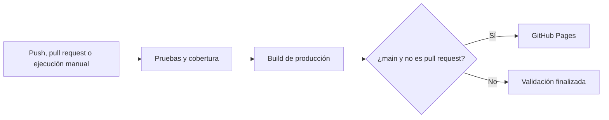

# Enfoque · CI/CD con GitHub Actions

[](https://github.com/20242505/ci-cd-web-demo/actions/workflows/ci-cd.yml)

Aplicación web de tareas que demuestra un flujo completo de integración y despliegue continuos: probar el código, comprobar su cobertura, construir el sitio y publicarlo en GitHub Pages.

**Proyecto académico:** aplicación web simple con pipeline CI/CD. Implementación original; la plantilla de la clase no se adjuntó y el diagrama del aula virtual no estuvo accesible. El diagrama de este repositorio representa la solución implementada.

## Aplicación

- Crear tareas de hasta 100 caracteres.
- Marcar tareas como completadas y eliminarlas.
- Filtrar por todas, pendientes o completadas.
- Consultar contadores y conservar las tareas en el navegador mediante `localStorage`.
- Utilizar la interfaz desde móvil o escritorio, con controles etiquetados y navegación por teclado.

Los datos permanecen en el navegador utilizado. No hay servidor, registro de usuarios ni sincronización entre dispositivos.

## Requisitos e instalación

Necesitas Node.js 22.19 o posterior, npm, Git y una cuenta de GitHub para publicar. El pipeline utiliza la versión 22. Comprueba tu instalación con `node --version`, `npm --version` y `git --version`.

Clona el repositorio:

```bash
git clone https://github.com/20242505/ci-cd-web-demo.git
cd ci-cd-web-demo
npm ci
npm run dev
```

Si trabajas con la copia descargada, abre su carpeta y ejecuta los dos últimos comandos. Abre la dirección local indicada por Vite. `npm ci` instala exactamente las versiones registradas en `package-lock.json`.

## Comandos

| Comando | Uso |
| --- | --- |
| `npm run dev` | Iniciar el servidor de desarrollo. |
| `npm test` | Ejecutar todas las pruebas una vez. |
| `npm run test:watch` | Repetir las pruebas al guardar cambios durante el desarrollo. |
| `npm run test:unit` | Ejecutar las pruebas unitarias. |
| `npm run test:integration` | Ejecutar las pruebas de integración. |
| `npm run test:coverage` | Ejecutar pruebas y comprobar los umbrales de cobertura. |
| `npm run build` | Generar el sitio estático en `dist/`. |
| `npm run preview` | Revisar localmente el sitio generado. |
| `npm run check` | Comprobar cobertura y construir el sitio. |

Para comprobar la versión de producción:

```bash
npm run check
npm run preview
```

## Estructura

```text
.github/workflows/ci-cd.yml   Automatización de pruebas, build y despliegue
src/                        Lógica de tareas, almacenamiento e interfaz
tests/                      Pruebas unitarias y de integración
docs/                       Documentación, informe y guion de demostración
index.html                  Entrada de la aplicación
package.json                Dependencias y comandos
package-lock.json           Versiones reproducibles
vite.config.js              Configuración de build y pruebas
```

## Pipeline

Los cambios enviados a `main`, las solicitudes de incorporación dirigidas a `main` y la ejecución manual activan el workflow. Primero se ejecutan las pruebas con cobertura; si pasan, se construye el sitio. El despliegue solo se permite desde `main` y nunca se realiza desde una solicitud de incorporación.



Una prueba fallida o una cobertura inferior al 90 % en líneas, ramas, funciones o instrucciones impide continuar hacia build y despliegue. Los reportes de cobertura se conservan como artefactos de la ejecución.

## Pruebas

Las pruebas unitarias comprueban validación, cambios inmutables, filtros, estadísticas y almacenamiento. Las pruebas de integración conectan la interfaz, la lógica de tareas y el almacenamiento en un entorno DOM con jsdom; incluyen interacciones y restauración de datos. Este entorno no sustituye la revisión manual en un navegador real.

`npm run test:coverage` genera un informe HTML dentro de `coverage/`. Abre `coverage/index.html` para revisar qué partes se ejecutaron.

La cobertura incluye los módulos JavaScript de `src/`, salvo `src/main.js`, que únicamente inicia la aplicación e importa los estilos. El comportamiento se comprueba a través de `mountApp`.

## Publicación y evidencias

Repositorio público: [20242505/ci-cd-web-demo](https://github.com/20242505/ci-cd-web-demo). Aplicación publicada: [Enfoque en GitHub Pages](https://20242505.github.io/ci-cd-web-demo/).

La [ejecución correcta de `main`](https://github.com/20242505/ci-cd-web-demo/actions/runs/42506979620) completó pruebas, build y despliegue para el commit `f448f6e35d2cc7058441ef1d633fd224fcaedb1b`. En Chrome se comprobó añadir dos tareas, completar una y recargar: los datos persistieron correctamente.

También se demostró el control de calidad en el [pull request #2](https://github.com/20242505/ci-cd-web-demo/pull/2): una [prueba intencionalmente fallida](https://github.com/20242505/ci-cd-web-demo/actions/runs/42507060493) impidió continuar y la [corrección posterior](https://github.com/20242505/ci-cd-web-demo/actions/runs/42507202230) aprobó las 31 pruebas de esa rama y el build, sin desplegar desde el pull request.

Validación local realizada el 8 de noviembre de 2026: 30 pruebas aprobadas (22 unitarias y 8 de integración), build de producción correcto y 0 vulnerabilidades detectadas por `npm audit`. Cobertura: 98.24 % de instrucciones, 94.73 % de ramas, 95.83 % de funciones y 99.02 % de líneas.

Consulta el [registro de evidencias](docs/IMPLEMENTATION_REPORT.md#evidencias) para conocer qué se verificó realmente.

## Documentación

- [Funcionamiento del pipeline](docs/PIPELINE.md)
- [Publicación y recuperación de despliegues](docs/DEPLOYMENT.md)
- [Guía de contribución](CONTRIBUTING.md)
- [Informe de implementación y evidencias](docs/IMPLEMENTATION_REPORT.md)
- [Guion de presentación y lista de entrega](docs/DEMO.md)
- [Presentación PowerPoint paso a paso](docs/Presentacion-CI-CD-Enfoque.pptx)

## Referencias

- [Workflows de GitHub Pages](https://docs.github.com/en/pages/getting-started-with-github-pages/using-custom-workflows-with-github-pages)
- [Desplegar Vite en GitHub Pages](https://vite.dev/guide/static-deploy.html#github-pages)
- [Cobertura con Vitest](https://vitest.dev/guide/coverage.html)
