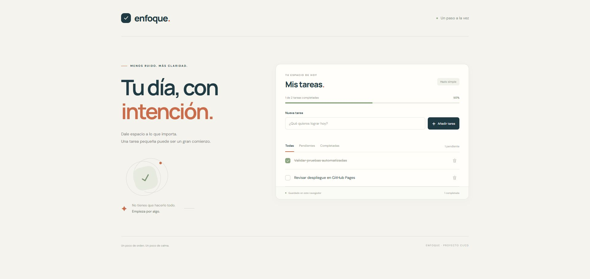
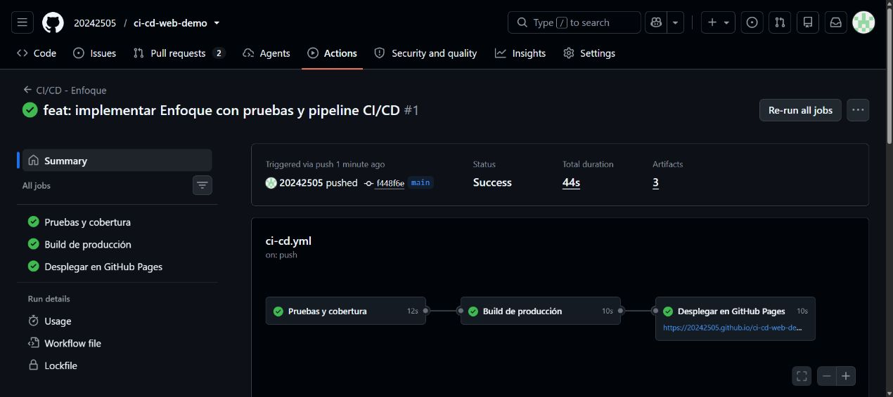

# Informe de implementación

## Datos del trabajo

| Campo | Valor |
| --- | --- |
| Proyecto | Enfoque: aplicación web y pipeline CI/CD |
| Fecha de preparación | 8 de noviembre de 2026 |
| Modalidad | Práctico individual o en parejas |
| Autor | Pedro Eusebio |
| Matrícula y sección | No proporcionadas; añadirlas antes de la entrega académica. |
| Repositorio público | [20242505/ci-cd-web-demo](https://github.com/20242505/ci-cd-web-demo) |

## Objetivo y alcance

Implementar una aplicación web simple que permita demostrar la automatización de pruebas y despliegue mediante GitHub Actions. La solución incluye un gestor de tareas, pruebas unitarias y de integración, cobertura, build estático y configuración para GitHub Pages.

La plantilla de aplicación mencionada en la consigna no se adjuntó. Tampoco se pudo consultar la imagen del pipeline alojada en el aula virtual. Se preparó una implementación original y un diagrama propio alineados con los requisitos textuales disponibles.

## Decisiones de implementación

| Decisión | Justificación |
| --- | --- |
| JavaScript y Vite | Mantener una aplicación pequeña, un servidor local sencillo y un build reproducible. |
| Funciones de tareas separadas del DOM | Probar las reglas sin depender de la interfaz y facilitar cambios. |
| `localStorage` | Persistir tareas sin servidor ni credenciales. |
| Vitest y jsdom | Probar lógica e interacciones de la interfaz en la misma herramienta. |
| Cobertura v8 con mínimo del 90 % | Añadir una condición de calidad verificable en cada ejecución. |
| Jobs encadenados | Evitar construir y publicar cuando falla la etapa anterior. |
| Publicación solo desde `main` | Mantener las ramas de desarrollo y pull requests como validaciones. |
| GitHub Pages | Publicar los archivos estáticos con las acciones oficiales. |

## Funcionamiento del pipeline

El workflow se activa por cambios en `main`, solicitudes de incorporación hacia `main` y ejecución manual. `test` instala dependencias y ejecuta las pruebas con cobertura. `build` depende de la validación y genera `dist/`. `deploy` depende del build y solo publica cuando la ejecución corresponde a `main` y no es un pull request.

El informe de cobertura queda disponible como artefacto de la ejecución cuando se genera. La autorización temporal de GitHub evita configurar tokens personales para Pages. Los detalles y el diagrama están en [PIPELINE.md](PIPELINE.md).

## Estrategia de pruebas

Las pruebas unitarias verifican validación de títulos, operaciones inmutables, selección de tareas, estadísticas y recuperación de almacenamiento. Las pruebas de integración conectan interfaz, lógica y persistencia: crear una tarea, completarla, aplicar filtros, eliminarla y restaurarla al montar de nuevo la aplicación.

También se comprueban entradas inválidas y comportamientos de error. Las pruebas no requieren un servicio remoto. La verificación visual y el acceso a GitHub Pages deben realizarse además en un navegador real.

## Evidencias

Registrar únicamente resultados observados. Los estados pendientes no equivalen a una demostración completada.

| Evidencia | Estado y resultado |
| --- | --- |
| Instalación reproducible con `npm ci` | Completada localmente el 8 de noviembre de 2026. |
| Pruebas unitarias | 22 aprobadas. |
| Pruebas de integración | 8 aprobadas. |
| Cobertura | Instrucciones 98.24 %; ramas 94.73 %; funciones 95.83 %; líneas 99.02 %. Todas superan el 90 % mínimo. |
| Build de producción | `npm run check` completado: pruebas y build de Vite correctos. |
| Auditoría de dependencias | `npm audit`: 0 vulnerabilidades detectadas al comprobar esta versión. |
| Repositorio remoto | Creado y público: [20242505/ci-cd-web-demo](https://github.com/20242505/ci-cd-web-demo). |
| Ejecución en GitHub Actions | [Ejecución 42506979620](https://github.com/20242505/ci-cd-web-demo/actions/runs/42506979620) correcta: `test`, `build` y `deploy` aprobados para el commit `f448f6e35d2cc7058441ef1d633fd224fcaedb1b` de `main`. |
| Sitio en GitHub Pages | Publicado mediante workflow en [Enfoque](https://20242505.github.io/ci-cd-web-demo/). Verificado en Chrome: añadir dos tareas, completar una y recargar conservó las tareas y su estado. |
| Detección de fallo del pipeline | [Ejecución 42507060493](https://github.com/20242505/ci-cd-web-demo/actions/runs/42507060493) fallida en el [pull request #2](https://github.com/20242505/ci-cd-web-demo/pull/2), rama `codex/demo-quality-gate`, commit `89c7d78c77c9ceed27cf52356d3d1c63de80e1d6`: 30 pruebas correctas y una aserción intencionalmente incorrecta. `build` y `deploy` omitidos. |
| Recuperación del pipeline | [Ejecución 42507202230](https://github.com/20242505/ci-cd-web-demo/actions/runs/42507202230) correcta para el commit `e6dc595e397d2e9807f8eea94b3756a268a86dd7`: 31 pruebas aprobadas, build correcto y deploy omitido, como corresponde a un pull request. |
| Presentación | [Presentación PowerPoint paso a paso](Presentacion-CI-CD-Enfoque.pptx), alternativa permitida por la consigna. El vídeo de YouTube es opcional si se entrega la PPTX. |

Para conservar evidencia, añade enlaces a ejecuciones y capturas con fecha, sin publicar credenciales. El guion de [DEMO.md](DEMO.md) permite mostrar tanto una ejecución correcta como la detección de un fallo, en vídeo o acompañando una presentación.

### Capturas de evidencia

Los estados y commits consultados mediante la API de GitHub se conservan en [verification-results.json](evidence/verification-results.json). El desglose local de cobertura se conserva en [coverage-summary.json](evidence/coverage-summary.json). Las capturas siguientes corresponden a la ejecución y al sitio comprobados el 8 de noviembre de 2026.

Sitio publicado en GitHub Pages:

Ejecución de `main` con las tres etapas aprobadas:

### Demostración del control de calidad

La rama de demostración añade una prueba extra que comprueba las estadísticas de una lista vacía. La primera versión esperaba incorrectamente `pending = 1`, cuando el resultado correcto era `0`. El registro de Actions mostró `expected +0 to be 1`, falló `test` y omitió sus etapas dependientes. La aserción se corrigió para esperar `0` sin cambiar la implementación ni reducir la cobertura.

La suite de `main` contiene 30 pruebas. La rama de demostración contiene 31 por esa prueba adicional; no debe confundirse su cantidad con el resultado de `main`. La ejecución corregida aprobó las 31 pruebas y el build, mientras que el deploy quedó omitido por ser un pull request. El pull request conserva la evidencia del fallo y la corrección y se cierra sin integración para mantener `main` con sus 30 pruebas.

## Relación con la rúbrica

| Criterio | Peso | Elementos entregados y comprobaciones |
| --- | --- | --- |
| Funcionalidad del pipeline | 40 % | Workflow, dependencias entre jobs, publicación real y bloqueo/recuperación comprobados con las ejecuciones enlazadas. |
| Calidad del código y pruebas | 30 % | Separación de lógica, pruebas unitarias/integración y umbral de cobertura. |
| Documentación | 20 % | README, pipeline, contribución, despliegue e informe. |
| Presentación y demo | 10 % | Guion paso a paso, presentación PowerPoint y enlaces a ejecuciones correctas, fallida y corregida. |

## Limitaciones y riesgos

- Los datos se guardan por navegador y origen; borrar el almacenamiento elimina las tareas. La copia local y el sitio publicado tienen almacenamientos independientes.
- No existe un backend ni autenticación; el alcance es una demostración de CI/CD para una aplicación estática.
- jsdom comprueba interacciones, pero no acredita el diseño ni la compatibilidad de todos los navegadores.
- El workflow impide desplegar una ejecución fallida. Para impedir también su integración debe configurarse protección de rama con comprobaciones obligatorias.
- El despliegue depende de que Pages esté habilitado y de los permisos y reglas del repositorio.
- La presentación puede entregarse en PowerPoint, como permite la consigna. Si se elige la opción de vídeo, todavía hay que grabarlo y publicar su enlace.

## Conclusión técnica

La implementación establece una ruta reproducible desde los cambios de código hasta un sitio estático: validación automatizada, control de cobertura, build y despliegue condicionado. La entrega debe acompañarse de las evidencias reales de la tabla anterior para acreditar su ejecución y publicación.
