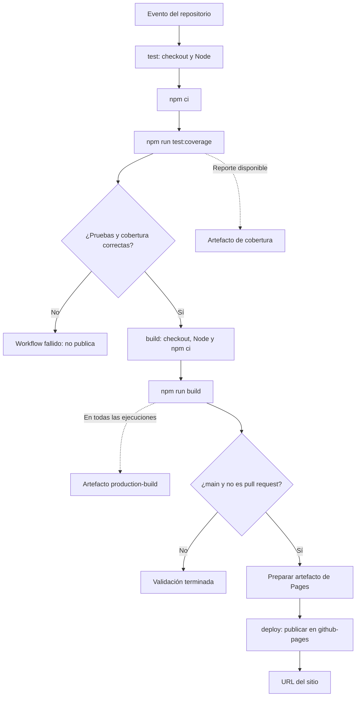

# Documentación del pipeline

## Propósito

El workflow `.github/workflows/ci-cd.yml` automatiza la validación y publicación de Enfoque. La integración continua detecta cambios que rompen comportamientos o no cumplen la cobertura. El despliegue continuo publica únicamente la versión validada de la rama `main` en GitHub Pages.

## Eventos

| Evento | Pruebas y cobertura | Build | Despliegue |
| --- | --- | --- | --- |
| `push` a `main` | Sí | Si pasan las pruebas | Si el build termina correctamente |
| `pull_request` dirigido a `main` | Sí | Si pasan las pruebas | Nunca |
| `workflow_dispatch` en `main` | Sí | Si pasan las pruebas | Si el build termina correctamente |
| `workflow_dispatch` en otra rama | Sí | Si pasan las pruebas | Nunca |

## Dependencias entre etapas

El diagrama se elaboró para esta implementación. No es una transcripción de la imagen del aula virtual, cuyo contenido no pudo consultarse.

## Etapa `test`

1. Descarga el código de la revisión que activó el evento.
2. Configura Node.js y el caché de descargas de npm.
3. Ejecuta `npm ci`, respetando `package-lock.json`.
4. Ejecuta las pruebas unitarias y de integración con cobertura v8.
5. Conserva el informe de cobertura como artefacto cuando se haya generado.

El caché acelera las descargas, pero no sustituye la instalación de dependencias ni la ejecución de pruebas. Las métricas mínimas globales son 90 % para instrucciones, ramas, funciones y líneas. Una suite con todas las pruebas aprobadas puede fallar si no alcanza alguna de estas métricas.

La cobertura incluye `src/**/*.js`, excepto el punto de entrada `src/main.js`, que solo importa estilos e inicia la aplicación. El informe se llama `coverage-report` y se conserva 14 días. Se intenta subir incluso si fallan las pruebas, siempre que exista `coverage/coverage-summary.json`.

## Etapa `build`

Depende de `test` mediante `needs`, por lo que no empieza si falla la validación. Instala las dependencias en un entorno nuevo y ejecuta Vite para generar `dist/`. Esa carpeta contiene el HTML, CSS y JavaScript que GitHub Pages servirá.

La configuración `base: './'` de Vite genera rutas relativas, por lo que el sitio funciona dentro de `/ci-cd-web-demo/` sin fijar ese nombre en el código. El build se conserva en el artefacto `production-build` durante 14 días, también para pull requests. Cuando corresponde publicar, se prepara además el artefacto `github-pages`.

## Etapa `deploy`

Depende de `build`. Su condición comprueba que la referencia sea `refs/heads/main` y que el evento no sea `pull_request`. Publica el artefacto preparado para Pages en el entorno `github-pages` y expone la URL del sitio en la ejecución.

El workflow utiliza los permisos de lectura mínimos por defecto. La etapa de publicación recibe `pages: write` e `id-token: write`, necesarios para publicar mediante las acciones oficiales. No se necesita crear un token personal ni guardarlo como secreto del repositorio.

La concurrencia agrupa las ejecuciones por workflow y referencia: en los pull requests, una ejecución nueva cancela una anterior en curso de la misma referencia. Las publicaciones usan además el grupo `github-pages`, con cancelación desactivada, para publicar una a la vez sin interrumpir el despliegue activo.

## Versiones y reproducibilidad

Las acciones están fijadas a identificadores completos de commit, con un comentario que indica su versión: `checkout@v7`, `setup-node@v7`, `upload-artifact@v7`, `configure-pages@v6`, `upload-pages-artifact@v5` y `deploy-pages@v5`. Esto evita que un cambio posterior de una etiqueta modifique automáticamente el código de la acción ejecutada.

Las dependencias directas de desarrollo están fijadas en `package.json`: Vite 8.3.6, Vitest y su proveedor de cobertura 5.1.0, y jsdom 29.1.1. `package-lock.json` registra también las dependencias transitivas. El runner usa `ubuntu-latest` y Node 22; esas dos referencias reciben actualizaciones de su plataforma y versión principal respectivamente.

## Cómo interpretar los resultados

- **Correcto:** las etapas aplicables terminan en verde.
- **Fallido en pruebas:** revisar el nombre del caso fallido y su resultado esperado.
- **Fallido por cobertura:** abrir el reporte y añadir casos de comportamiento relevantes.
- **Fallido en build:** revisar la instalación, las importaciones y el registro de Vite.
- **Fallido en deploy:** comprobar que Pages usa GitHub Actions, los permisos y las reglas del entorno.
- **Deploy omitido:** es normal en un pull request o en una ejecución manual fuera de `main`.

## Límites y mejoras

Las pruebas de integración se ejecutan con jsdom; no comprueban el diseño visual ni todos los comportamientos de un navegador real. Para ampliar el proyecto pueden añadirse pruebas en navegador y protección de `main` con comprobaciones obligatorias. El workflow evita desplegar una revisión fallida, pero no bloquea por sí mismo su integración en Git.

## Fuentes

- [Workflows personalizados para GitHub Pages](https://docs.github.com/en/pages/getting-started-with-github-pages/using-custom-workflows-with-github-pages)
- [Despliegue estático de Vite](https://vite.dev/guide/static-deploy.html#github-pages)
- [Cobertura de Vitest](https://vitest.dev/guide/coverage.html)
